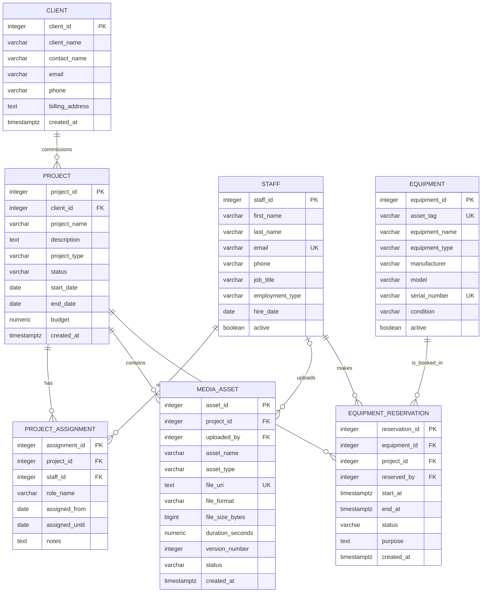

# Media Production Database ER Diagram (Draft)

> Review draft produced with AI assistance. Verify the entities, optionality,
> and relationship labels before using it in assessed work.

`MEDIA_ASSET.uploaded_by` is nullable, so each asset has zero or one uploader;
one staff member may upload zero or many assets. Every other foreign key is
`NOT NULL`: each child row has exactly one referenced parent, while a parent may
have zero or many child rows. The diagram shows structure; the SQL draft contains
the detailed checks and the rule that prevents overlapping confirmed or
checked-out reservations.

